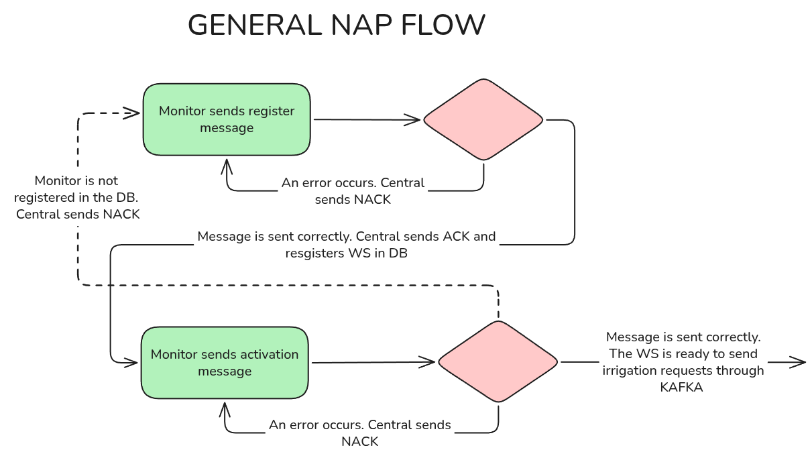

# UA-SD
This repository containts all the resources related to the Practice 2 of Distributed Systems

## Shared protocols


### NAP protocol

This protocol is used to authenticate the watering stations with central. The specification for the protocol can be found [here](shared/NAP-protocol-spec.md).




<br>

## Kafka
This section explains the structure and distribution of the topics created in Kafka along with the structure of the respective JSON messages used in each topic to transfer data.


### Telemetry
This topic is used for all the data that the engine sends to the central regarding to the irrigation measurements (flow, accum volume...). It operates via key-based hash addressing.
| `Producer` | `Consumers` |
|---|---|
| Watering station | Central, Field Operators |
<br>

The JSON structure used in this topic is the following:
```json
{
  "station_id": "<integer: ID of the station sending the data>",
  "flux_l_min": "<number: Irrigation flow rate in liters per minute>",
  "operator_id": "<integer|null: ID of the operator who started irrigation; null if irrigation was not started by any>"
}
```

`"operator_id"` → Key used for partition routing for field operators, central will consume from every partition.

---
<br>


### FO-Req
This topic is the one the operators use to send operation commands to the central — such as start an irrigation, block an station or activate an station.
| `Producer` | `Consumer` |
|---|---|
| Field Operator | Central |
<br>

The JSON structure used in this topic is the following:
```json
{
  "operator_id": "<integer: Operator ID>",
  "station_id": "<integer: ID of the target station>",
  "command_type": "<string: Command type>",
  "operation_code": "<integer: Unique operation ID>",
  "duration": "<integer|null: Irrigation duration. Optional; null for indefinite irrigation>"
}
```
`"command_type"` can be one of the following values:
- `"IRRIGATION"` → Start irrigation.
- `"BLOCK"` → Block a station. (`"duration"` is ignored.). If the station is irrigating, it stops and enters state `Out of service`
- `"ACTIVATE"` → Unblock a station. (`"duration"` is ignored.)
- `"STOP"` → Stops the irrigation of an station, but the stations enters state `Available`
- `"GET-STATIONS"` → Request the list of available stations from the Central system. (`"duration"` is ignored.)
---
<br>

### Central-notis
This topic is used by the central to send notifications to the field operators, such as operation confirmations or station status updates
| `Producer` | `Consumer` |
|---|---|
| Central | Field Operator |
<br>

The JSON structure used in this topic is the following:
```json
{
  "operator_id": "<integer: ID of the operator the message is addressed to>",
  "type": "<string: Message type>",
  "operation_code": "<integer|null: ID of the confirmed or rejected operation; null if the message is not a response>",
  "status": "<string: OK if the operation was successfull, KO if not>",
  "reason": "<string: Reason for KO response>"
  "stations": "<array|null: List of requested stations (only for GET-STATIONS)>",
  "summary": "<tuple|null: Summary data for an irrigation session>"
}
```
`"operator_id"` → Key used for partition routing.

`"type"` can be one of the following:

- `"RESPONSE"` → Used for responses or command confirmations. (`"summary"` is ignored.)
- `"SUMMARY"` → Used for summary data. (`"stations"` is ignored.)
  
`"stations"` → list of tuples with the form (`<station_id>`, `<location>`,`<status>`)<br>
`"summary"` → tuple with the form (`<station_id>`, `<total_time (mins)>`,`<total_liters (L)>`)

---
<br>

### WS-finish-conf
This topic is used by the stations to send confirmation to the central unit that irrigation has finished. The message will also contain a summary of the irrigation data.
| `Producer` | `Consumer` |
|---|---|
| Watering Station | Central |
<br>

The JSON structure used in this topic is the following:
```json
{
  "station_id": "<integer: ID of the station sending the data>",
  "status": "FINISHED",
  "total_liters": "<number: Total liters of water used>",
  "total_time": "<number: Total irrigation time>",
  "operator_id": "<integer|null: ID of the operator who started irrigation; null if irrigation was not started by any>"
}
```
---
<br>

### Central-ops
This topic is used by the central unit to send operational commands, such as locking a station or starting irrigation for a station, provided that the station is available. This commands can be sent the central unit or by a field operator via central.
| `Producer` | `Consumer` |
|---|---|
| Central | Watering Station |
<br>

The JSON structure used in this topic is the following:
```json
{
  "operator_id": "<integer|null: ID of the operator sending the operation; null if sent by the Central system>",
  "station_id": "<integer: ID of the target station>",
  "type": "<string: Operation type>",
  "operation_code": "<integer: Unique operation ID>",
  "duration": "<integer|null: Irrigation duration; null to continue until irrigation is manually stopped>"
}
```

`"station_id"` → Key used for partition routing.

`"type"` can be one of the following:

- `"IRRIGATION"` → Start irrigation.
- `"BLOCK"` → Block a station. (`"duration"` is ignored.). If the station is irrigating, it stops and enters state `Out of service`
- `"ACTIVATE"` → Unblock a station. (`"duration"` is ignored.)
- `"STOP"` → Stops the irrigation of an station, but the stations enters state `Available`
---
<br>

### WS-start-conf
This topic is used by the stations to send confirmation or rejection of each operation previously sent by the central unit. This means that, via this topic, the station will confirm to the central unit all operations received — whether they were initiated by the central unit itself or by a field operator.
| `Producer` | `Consumer` |
|---|---|
| Watering Station | Central |
<br>

The JSON structure used in this topic is the following:
```json
{
  "operation_code": "<integer: ID of the confirmed or rejected operation>",
  "status": "<string: OK or KO>",
  "reason": "<string|null: Reason for the KO response>"
}
```
