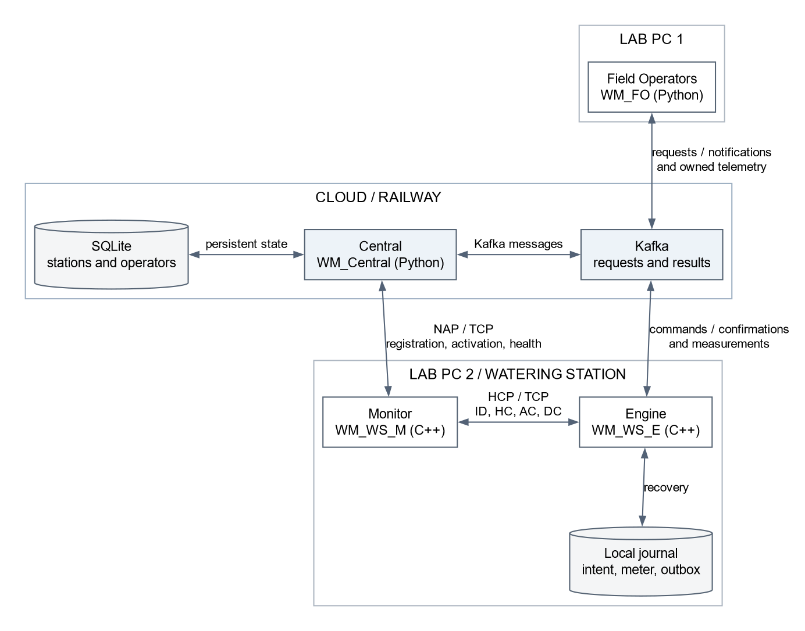

<div class="page-break"></div>

# Contents {.unnumbered}

1. [Practice Description](#overview)
2. [General overview](#architecture)
3. [Following an irrigation request](#request)
4. [Central and the field operator](#central-fo)
5. [Inside a watering station](#station)
6. [The socket protocols: NAP and HCP](#sockets)
7. [The Kafka messages](#kafka)
8. [State, concurrency and recovery](#recovery)
9. [Deployment and demonstration](#deployment)
10. [Testing and results](#testing)
11. [Source references](#sources)

<div class="page-break"></div>

# 1. Practice Description {#overview}

This practice implements a distributed irrigation system. A field operator can
choose a watering station, request irrigation and follow its progress. Central
coordinates the requests, while each station controls a simulated valve and
measures the water delivered. A separate Monitor checks Engine and reports the
station's health to Central.

The application uses Python for Central and Field Operator, C++23 for Engine
and Monitor, Kafka for operational messages, and SQLite for Central's database.
The executable names are `WM_Central`, `WM_FO`, `WM_WS_E` and `WM_WS_M`. Docker
provides the deployment environment used in the lab and in the cloud.

The following sections describe the modules, their message formats, the station
states and the deployment procedure. Code references identify the corresponding
implementation files. The report follows the organisation and behaviour covered
in the practice; it does not reproduce the source code in full.

# 2. General overview {#architecture}



We split communication into two paths. **Kafka carries work and results**:
requests, station commands, confirmations, measurements and final summaries.
**TCP sockets carry supervision**: station registration, activation and health.
Keeping those paths separate lets us distinguish a working Engine from a station
whose supervision has disappeared.

| Component | Main responsibility | What it talks to |
|---|---|---|
| Central | Register stations, coordinate operations and maintain the network view | Monitor over NAP; Kafka; SQLite |
| Field Operator | Let an operator request work and see their station's progress and result | Kafka |
| Engine | Control the valve, integrate measurements, execute commands and retain recovery data | Monitor over HCP; Kafka; local journal |
| Monitor | Check Engine and report station health independently | Engine over HCP; Central over NAP |

Central, Kafka and SQLite are hosted in the cloud. The minimum lab scenario uses
one machine for two FO instances and another for two watering stations. Each WS
still consists of two independent processes and containers: Engine and Monitor.
They share a Docker bridge network, not a process or network namespace.

On NAP, **Central is the TCP server and Monitor is the client**. On HCP,
**Engine is the server and Monitor is the client**. This is the direction used in
our implementation and the agreed clarification for the practice. Engine gets
its station ID from Monitor's initial identification message, so both halves of
a station use the same identity.

The main entry points are small on purpose. Python's `main()` functions prepare
the service and workers. In C++, `WM_WS_E.cpp` and `WM_WS_M.cpp` parse options,
open the log and hand execution to the application layer. The protocol and
watering logic live outside those entry points. See [S1], [S5], [S8] and [S9].

# 3. Following an irrigation request {#request}

Suppose operator **7** requests **120 seconds** of watering from station **1**.
We use operation code **101** to keep this example readable.

1. FO publishes the request on `fo-req`.
2. Central checks that the station exists and is Available. A rejected request
   receives a reason; a valid one becomes an `IRRIGATION` command on `central-ops`.
3. Engine checks the command again. Central's view may have become outdated, so
   Engine is the final authority on whether the valve can open safely.
4. Before changing the valve, the station saves the operation intent. It then
   starts irrigation and queues an `OK` confirmation on `ws-start-conf`.
5. Central uses that confirmation to update the station and answer FO through
   `central-notis`. We correlate the whole exchange with operation code 101.
6. While watering, Engine publishes telemetry once per second. Central can observe
   the station, and FO only displays telemetry addressed to its operator ID.
7. At the deadline, the valve closes. Engine queues `ws-finish-conf` with the
   final litres, duration and the operator who started the irrigation. Central
   forwards the summary to FO.

The station confirmation distinguishes a requested irrigation from one that
Engine actually accepted. For example, a leak may appear during the exchange
and prevent the valve from opening.
The final summary has a different job. It reports actual usage and keeps the
original operator, even if somebody else stopped the irrigation.

A manual start follows the same station-side rules. Its confirmation contains
`station_id` and a null or omitted `operation_code`; Central recognises that the
station initiated it. Its `operator_id` is null because no FO owns that session.
See the handlers in [S1] and the station command path in [S10].

# 4. Central and the field operator {#central-fo}

## 4.1 Central's coordination work

Central has two ways of receiving information: a TCP listener for Monitors and
Kafka consumers for station/FO messages. A worker thread handles each accepted
NAP connection. Separate Kafka workers dispatch incoming JSON to the handler
for its topic. One slow station therefore does not occupy the whole server.

The request handler checks the requested action against the station's state.
For example, an irrigation request needs an Available station; a BLOCK is refused
during a leak. Central forwards the accepted command and keeps the operation
correlation needed to deliver the eventual response to the right operator.

The confirmation handler distinguishes station-initiated irrigation from a
Central/FO operation. For a commanded operation, it uses the saved command type
to interpret `OK`: `IRRIGATION` means Watering, `BLOCK` means Out of service,
and `ACTIVATE` or `STOP` means Available. A `KO` carries a reason and does not
pretend that the requested state transition happened.

Central's network view uses the assignment's states: Available, Watering, Leak,
Out of service and Disconnected. Health reports provide liveness and fault
information; operational confirmations provide the watering/blocking state.
An ordinary health `OK` must not erase an ongoing irrigation or an administrative
block. This separation also matters when messages from different topics arrive
in different orders. See [S1] and [S2].

The final dashboard shows each station's ID, location and state. Watering rows
also show the operator, flow in L/min and accumulated litres. Available uses
green, Watering uses blinking green or an equivalent activity indicator, Leak
uses red, Out of service uses orange, and Disconnected uses gray. Central can
send irrigation, BLOCK and ACTIVATE to one chosen station or all stations;
STOP ends an individual irrigation without blocking it.

On startup, saved registrations are shown as Disconnected until their Monitors
reconnect. For the live volume display, we distinguish a Central-side running
value from the authoritative final meter total. The three-field telemetry
contract carries flow, not accumulated litres; the final accounting record
comes from `ws-finish-conf`.

## 4.2 SQLite and concurrent access

SQLite stores the stations' IDs, locations and states, together with registered
operator IDs. The station table also keeps `previous_status` for leak recovery.
We mount the database directory on persistent storage, so replacing a container
does not remove its registration data.

Database writes go through a queue and a single writer thread. Read operations
open their own connections, and WAL mode allows reads to proceed alongside the
writer. This keeps the socket threads and Kafka workers from writing through the
same SQLite connection concurrently.

Queueing a write is not the same as committing it. Any flow that immediately
depends on a just-written row needs to respect that ordering. Similarly, SQLite
persistence and Kafka acknowledgement are different boundaries: one does not
automatically prove that the other completed. The database implementation is
collected in [S3].

## 4.3 The operator's interface

We keep the FO workflow centred on a few actions: choose a station, request
irrigation, stop it, block or activate it, and inspect the station list. The GUI
presents those actions and displays confirmations, current flow and the final
summary. The same request/response logic can be followed in the command-line
workflow, which is useful when testing a container without a graphical display.

FO does not connect directly to a station. It sends JSON to Kafka and lets
Central decide whether the request should proceed. One consumer receives
`central-notis`; another receives `telemetry`. Notifications go into a queue,
while telemetry uses a one-item queue that keeps the newest reading rather than
building up a backlog of old display values.

FO also accepts a file of requests. Each non-empty line contains a station ID,
optionally followed by `#` and a duration in seconds:

```text
1#120
2
1#60
```

Here the second request has no duration limit. The file reader converts these
lines into the same requests used by the interactive controls. Playback is
sequential: FO waits until the service finishes or fails, then waits four seconds
before the next request. An indefinite request therefore needs to be stopped
before playback can continue. FO's request flow
and Kafka adapter are in [S5] and [S6]; file parsing is in [S7].

> **Screenshot 1 — Field Operator.** Insert the final FO GUI with operator 7,
> the station list, station 1 selected, and a visible successful irrigation
> response. Keep the ID, duration and status readable.

# 5. Inside a watering station {#station}

## 5.1 Engine: the physical simulation and its permissions

Engine owns the simulated valve, flow meter and leak detector. A shared worker
checks deadlines and sensors approximately every 100 ms. The `Engine` mutex
protects its state, so an incoming command cannot interleave half a valve change
with fault handling.

The flow is not a fixed number on the screen. We model small pressure variations
within 2% below the configured setting. For a 40 L/min request, the reading stays
roughly between 39.2 and 40 L/min. The volume calculation integrates the same
varying curve over elapsed time; it does not multiply a last sample by the whole
duration. Closing the valve fixes the final totals.

We use a steady clock for irrigation time and deadlines. Changing the machine's
wall clock should not extend an irrigation. UTC wall-clock timestamps are used
for logs, where an understandable calendar time is more useful.

Engine separates physical state from permissions. Idle, Watering and Fault are
physical states; activation, Central availability, Monitor connectivity and
administrative blocking are additional conditions. This is why a healthy answer
does not automatically mean “you may start watering”. A start must pass all the
relevant guards. See [S11] and [S12].

## 5.2 Start, STOP, BLOCK and ACTIVATE

| Action | Meaning at the station |
|---|---|
| `IRRIGATION` | Start only if the station is active, healthy, supervised, unblocked and has Central available. |
| `STOP` | Close the current irrigation but keep activation. Also return `OK` if already Available. |
| `BLOCK` | End irrigation and deliberately disable new starts. Reject a new block during an active leak. |
| `ACTIVATE` | Clear a deliberate block when the health and supervision checks permit it. Do not start watering automatically. |

`STOP` and `BLOCK` therefore solve different problems. To finish one irrigation
and accept another later, we use STOP. To put the station Out of service until
an explicit external activation, we use BLOCK. STOP cannot repair a fault,
unblock a station or activate one that has not yet been authorised.

A block accepted before a leak survives repair. A new block received during
that leak is rejected with `KO`, without replacing the fault. We also preserve
the saved block during restart, even if the sensor faults before recovery loads
the journal. Restoring an existing decision is different from accepting a new
BLOCK command.

The local Engine menu exposes start, stop, fault, repair, status and quit. It
refreshes watering time, flow and delivered volume without needing another
command. Fault injection is also available while idle or blocked, so we can
demonstrate the health behaviour without starting irrigation first.

> **Screenshot 2 — Engine during irrigation.** Insert Engine showing station 1,
> Active, Watering, positive delivered litres and elapsed time. Capture two nearby
> readings if possible so the changing flow and time are visible.

## 5.3 Monitor: supervision without controlling the valve

Monitor checks Engine once per second over HCP. Its NAP Reporter runs separately,
so a slow or unavailable Central does not stop local health checks. A valid NAP
activation and acknowledged healthy reporting authorise the HCP activation step.
Identification alone grants no permission to irrigate.

During a leak, HCP keeps responding `KO` and NAP keeps reporting `KO` on its
persistent health connection. Repair changes reporting back to `OK`. Once that
healthy report is acknowledged, Monitor renews Engine authorisation using HCP
`AC`; it does not reopen the NAP activation connection just because a leak was
repaired. This authorisation still cannot clear a Central block.

The terminal view and optional Qt panel use the same status observer. The panel
shows the station, Engine health, last response time, Central connection and
diagnostic paths. Help, the read-only activity log and Quit have keyboard
shortcuts; opening a dialog does not pause monitoring. Routine logs stay in
files, while fatal errors remain visible with a suggested next step. See [S9],
[S13] and [S14].

> **Screenshot 3 — Monitor.** Insert the Qt panel connected to Engine and Central,
> with Healthy/Available indicators, a recent health timestamp and the log
> controls. This should be a real connected run, not a layout mock-up.

# 6. The socket protocols: NAP and HCP {#sockets}

## 6.1 NAP framing and validation

NAP is the Monitor–Central protocol. Messages are UTF-8 text with `#` separators:

```text
NAP#1.0#<ack-code>#<protocol-code>[#fields]#<LRC>#FIN
```

`ack-code` identifies a request within its connection. The matching response
must carry the same code and station ID. This is separate from a Kafka
`operation_code`: one correlates a socket exchange; the other identifies a
watering/control operation.

The LRC is the XOR of the bytes before the separator preceding the checksum.
It is encoded as two uppercase hexadecimal digits. We exclude the checksum,
its preceding `#`, and `#FIN` from the XOR. This detects accidental frame
corruption; it is not encryption or proof of a sender's identity.

| Protocol code | Request/response body after the code |
|---|---|
| `0` Registration | `<station-id>#<location>` |
| `1` Activation | `<station-id>` |
| `2` Health/status | `<station-id>#OK` or `<station-id>#KO` |
| `3` ACK | `<station-id>` |
| `4` NACK | `<error-code>#<station-id>` |

For example, station 1's activation exchange is:

```text
Monitor -> Central: NAP#1.0#1#1#1#41#FIN
Central -> Monitor: NAP#1.0#1#3#1#43#FIN
```

The NACK error codes are 0 for malformed syntax, 1 for an already registered
station, 2 for an unknown station, and 3 for an unknown protocol code. An
already-registered response lets Monitor proceed to activation; it does not
mean that a duplicate registration should destroy the existing record.

Registration and activation use separate short-lived connections. After them,
health reporting uses one persistent connection. Both `OK` and `KO` receive an
ACK, and a fault does not close that connection. The normal reporting interval
is one second, configurable for tests.

TCP does not preserve application message boundaries. Central accumulates bytes
until it finds `#FIN`; Monitor reads one complete response and validates the
version, field count, request number, station ID and LRC. There is only one
outstanding request per connection. A truncated or late frame cannot safely
be reused as the reply to a different request. The wire specification and
implementation are in [S2], [S13] and [S15].

## 6.2 HCP identification and two-byte messages

HCP is deliberately smaller because it runs between one Monitor and its Engine.
Monitor connects to Engine and first sends:

```text
ID 1\n
```

The newline terminates identification. Engine answers `OK` or `KO`. It stores
the accepted ID and rejects a different identity on later connections until it
restarts. HCP permits a wider text ID format for health-only use, but a complete
Kafka deployment uses numeric station IDs.

After identification, each HCP request and response is exactly two bytes:

| Request | Meaning | Response |
|---|---|---|
| `HC` | Check Engine health | `OK` or `KO` |
| `AC` | Apply acknowledged recovery/activation authorisation | `OK`, or `KO` if activation is refused |
| `DC` | Central is unavailable; prevent new starts | `OK` acknowledges receipt |

No newline or null terminator follows these two-byte frames. The default
operation deadline is two seconds. A partial read does not restart the deadline.

`HC` answers health, including a latched fault: even a leak repaired between
polls must be reported at least once. `AC` answers permission to activate, so
its `KO` may mean that the hardware is healthy but Central deliberately blocked
it. `DC` is an availability notification and must not consume a pending leak or
close a valve that is allowed to finish its current irrigation.

When the HCP connection actually fails, Engine revokes activation, closes the
valve and suppresses Kafka publication until supervision is restored. HCP and
its deadline helpers are described in [S16] and implemented by [S17].

# 7. The Kafka messages {#kafka}

## 7.1 Topics, identities and routing

The JSON messages use numbers for IDs, not strings containing placeholders.
`operation_code` is a nonnegative integer supporting FO's full 128-bit UUID range.
It stays unchanged from FO's request through the command and confirmation.
The station preserves large codes as exact decimal digits and writes them as
JSON numbers, avoiding a conversion through floating point [S23].
`null` is meaningful: a Central-originated command has no FO, and a manually
started irrigation has no external operation code.

| Topic | Producer | Consumer(s) | Routing recipient |
|---|---|---|---|
| `fo-req` | FO | Central | Central consumes the topic |
| `central-ops` | Central | WS Engine | Station ID |
| `ws-start-conf` | WS Engine | Central | Central consumes all partitions |
| `ws-finish-conf` | WS Engine | Central | Central consumes all partitions |
| `telemetry` | WS Engine | Central and FO | Original operator ID; station ID for ownerless telemetry |
| `central-notis` | Central | FO | Operator ID |

WS-produced records use `numeric_id % number_of_partitions` for the recipient.
FO assigns its telemetry and notification consumers with this same modulo rule.
Different IDs can share a partition, so the consumer must still filter the JSON
recipient. For instance, operator IDs 1 and 4 share partition 1 when there are
three partitions, but must not display each other's messages.

For `central-ops`, Central supplies the station ID as a Kafka key and uses
librdkafka's default CRC32 partitioning. WS follows that key-based assignment,
using the canonical decimal station ID, so it reads the partition where Central
actually writes its commands. Recipient filtering still applies.

WS queries Kafka metadata and refreshes its partition counts every five seconds.
FO also queries its notification/telemetry topic counts when assigning its
consumers. We use distinct station/operator consumer groups so adding an
independent instance does not steal another recipient's commands. Increasing a
topic's partition count during irrigation is a separate migration problem:
the recipient's partition can change while older messages remain in the original one.
See [S4], [S6] and [S18].

## 7.2 Request, command and acknowledgement

The request from operator 7 is:

```json
{
  "operator_id": 7,
  "station_id": 1,
  "command_type": "IRRIGATION",
  "operation_code": 101,
  "duration": 120
}
```

On `central-ops`, the corresponding object uses `type` instead of
`command_type`; the other fields keep their meaning. `duration` is in seconds.
Null or omitted duration means no automatic time limit. Central forwards the
request only after checking the station, and Engine checks it again locally.

The other operational types are `BLOCK`, `ACTIVATE` and `STOP`; duration is
ignored for them. For example, this stops the current irrigation without
putting the station Out of service:

```json
{
  "operator_id": 7,
  "station_id": 1,
  "type": "STOP",
  "operation_code": 102,
  "duration": null
}
```

The operation response on `ws-start-conf` is:

```json
{
  "station_id": 1,
  "operation_code": 102,
  "status": "OK",
  "reason": null
}
```

Despite the topic's name, `ws-start-conf` confirms every operation, including
STOP, BLOCK and ACTIVATE. A rejected operation uses `KO` and a readable reason.
An already Available station acknowledges a new STOP with `OK` and creates no
second final summary.

Engine remembers each normalised command and its result. Repeating the same
operation code replays its confirmation; it does not repeat the valve action.
Reusing that code with different content is rejected. This is particularly
important for STOP: replaying an old stop must not terminate a newer irrigation.
See `Station::handle()` in [S10].

## 7.3 Measurements and completion

During watering, the telemetry object is deliberately small:

```json
{"station_id": 1, "flux_l_min": 39.72, "operator_id": 7}
```

The flow is in litres per minute. Telemetry does not carry final accumulated
usage; that belongs in `ws-finish-conf`. The agreed final-summary time unit is
minutes, while request durations and Engine's internal elapsed time use seconds.
Consumers need to make that conversion explicit rather than infer a unit from
the JSON number.

```json
{
  "station_id": 1,
  "status": "FINISHED",
  "total_liters": 79.4,
  "total_time": 2.0,
  "operator_id": 7
}
```

These figures are an illustrative two-minute session, not a measured test result.
The operator is the person who started the session. If another operator or
Central stops it, the result still belongs to the original owner. Manual
irrigation uses null ownership.

`FINISHED` records that a session ended. It does not mean that the station must
be Available: a session can also finish because of a leak or BLOCK. Central's
health and administrative state must take precedence over a late summary.

## 7.4 Notifications to FO

Central sends responses to the originating operator on `central-notis`:

```json
{
  "operator_id": 7,
  "type": "RESPONSE",
  "operation_code": 101,
  "status": "OK",
  "reason": null
}
```

For `GET-STATIONS`, the response also carries a `stations` array of
`[station_id, location, status]` entries. After irrigation, a `SUMMARY`
notification carries `summary: [station_id, total_time_minutes, total_litres]`.
These tuples become JSON arrays; they are not Python-specific objects on the
wire. Fields that are irrelevant to a notification may be omitted or null.

Operator filtering happens before data reaches the interface. Receiving a
partition does not entitle FO to see every station record in it. The shared
topic definitions are in [S19], with the message adapters in [S4] and [S6].

# 8. State, concurrency and recovery {#recovery}

## 8.1 What should happen when a component disappears?

| Event | Local effect | Recovery rule |
|---|---|---|
| Leak | Close the valve immediately; keep reporting `KO` | Repair, acknowledged healthy reporting and HCP authorisation; no automatic watering resume |
| Monitor stops | Engine stops watering and withholds Kafka publication | Restore supervision and authorisation |
| Engine stops | Monitor reports failure; Central shows the fault | Restore saved usage and send the interrupted session's final result |
| Central stops | Existing irrigation can finish; new starts are refused | Reconnect/re-authorise without restarting healthy components |
| FO stops | The station continues its service | Resume the operator's notifications/results after reconnecting |
| Kafka is unavailable | Retain pending station events locally | Retry delivery after the broker returns |

The Monitor/Engine combinations explain the visible failure states. If Monitor
is alive but Engine is not, Monitor can report a fault. If Monitor is down,
Central receives no life messages and must show Disconnected, whether Engine
is alive or not. Engine telemetry must not conceal that loss of supervision.

Central failure is deliberately less restrictive than Monitor failure. Monitor
can still supervise the valve locally, so an existing irrigation may finish.
It sends `DC` to prevent another start. When Central returns, a fresh
acknowledged exchange restores admission. Repair or reconnecting never clears
an administrative block by itself.

## 8.2 The station journal and pending messages

Engine's Kafka layer has three useful boundaries. `Station` understands the
messages and watering sessions. `Service` owns the broker clients and worker.
`Journal` saves the local state. Keeping those jobs separate makes it possible
to test a command without running a real broker.

The journal uses two alternating files, suffixed `.0` and `.1`. Each stores a
JSON object containing a revision and a state snapshot. On load, we parse both
and choose the highest valid revision. A torn latest file therefore does not
replace an older valid snapshot. If files exist but neither is valid, Engine
reports a controlled storage failure instead of silently starting with no state.

The snapshot contains the station identity, administrative block, current
session, pending intent, command/result cache, meter totals and outgoing events.
An outgoing event stores its topic, recipient and JSON value. The journal is
local recovery data, not a Kafka wire format. Schema version 2 keeps meter time
in seconds and outgoing final durations in minutes. Older checkpoints remain
readable; pending final durations from the previous schema are converted once
when loaded. Large operation codes use decimal strings inside this local file,
while their Kafka representation remains numeric.

We save intent before actuation and save outgoing records before publication.
A record is removed only after its broker delivery callback succeeds and that
removal is saved. The producer's idempotence helps broker retries, but the
application guarantee remains **at least once**: a crash after broker acceptance
and before the local removal checkpoint can replay a record. Central must
handle that replay; we do not claim distributed exactly-once accounting.

The file write is flushed and synchronised before the revision advances.
Windows uses the native commit operation; Unix uses file and directory `fsync`.
Those platform choices follow NINTTP's platform flags. See [S10], [S18] and [S20].

## 8.3 Retaining measurements without reopening the valve

The simulated meter exposes a progress snapshot only after that snapshot has
been saved. Sampling has a nominal 100 ms cadence, not a hard real-time bound.
The disk write happens outside Engine's state mutex, so closing a valve does
not have to wait for storage.

After a crash, the station restores the saved totals and owner, ends the
interrupted session and keeps its final result for delivery. It does not
reopen irrigation or count the time spent offline. A generation check prevents
a delayed snapshot from an older irrigation overwriting a new one.

This protects committed simulated usage. It does not reconstruct physical water
delivered between disk commits, and it cannot recover a volume that has itself
been deleted. For the same reason, each independent station needs its own state
volume rather than a shared journal file.

> **Screenshot 4 — Fault and repair.** Insert a real leak while watering: Engine
> stopped, Monitor reporting a fault, and Central showing Leak. Add the repaired
> view beside it; if the station was previously blocked, it must remain Out of
> service rather than start watering.

# 9. Deployment and demonstration {#deployment}

## 9.1 Preparing the cloud and images

We prepare the cloud before the lab demonstration. Kafka must advertise an
address reachable by the clients, Central must listen on its configured TCP
port, and SQLite must use a mounted persistent directory. The cloud endpoint
and broker address are configuration, not values compiled into WS.

The six required Kafka topics are `telemetry`, `fo-req`, `central-notis`,
`ws-finish-conf`, `central-ops` and `ws-start-conf`. We create them before
launching clients and use the same partition counts at both ends of each
recipient-routed interface.

Build the images **before** grading, from the repository root:

```sh
docker build -t wm-central WM_Central
docker build -t wm-fo WM_FO
docker compose -f WM_WS/compose.yaml -p ws-1 build
docker compose -f WM_WS/compose.yaml -p ws-2 build
```

The WS build context is `WM_WS`, not an individual executable folder, because
both modules need shared headers and CMake support. Compose reads that context
from its file and prepares image tags for each project. Building both `ws-1`
and `ws-2` beforehand avoids building missing images during grading. Python images use Python
3.12 and install `confluent-kafka`; SQLite comes with Python. The C++ builds use
CMake, Boost and NINTTP, plus librdkafka for Engine. Qt is optional for Monitor;
the container commands below use its terminal frontend. See [S21] and [S22].

For a self-managed Central container, its equivalent cloud configuration is:

```sh
docker volume create wm-central-db
docker run -d --name wm-central -p 8080:8080 \
  -v wm-central-db:/data -e DB_DIR=/data wm-central \
  --server-ip 0.0.0.0 --port 8080 \
  --kafka-ip iriguchi.proxy.rlwy.net --kafka-port 37040
```

On Railway, the same image/service receives these settings and a persistent
mount through the service configuration. Its public TCP proxy forwards to the
internal listening port. Central and SQLite are one application deployment
with a mounted database; SQLite is not a separate TCP database server.

## 9.2 Starting two field operators on lab PC 1

Use a separate terminal for each operator:

```sh
docker run -it --name wm-fo-7 wm-fo 7 \
  --kafka-ip iriguchi.proxy.rlwy.net --kafka-port 37040
```

```sh
docker run -it --name wm-fo-8 wm-fo 8 \
  --kafka-ip iriguchi.proxy.rlwy.net --kafka-port 37040
```

Those commands exercise the terminal workflow. The GUI uses the same operator
identity, requests and notifications; its launch requires the final GUI package
and a display. For request files, mount a local request directory into the
container and choose the path as seen inside that container.

## 9.3 Starting two watering stations on lab PC 2

We use Compose to supply the images, networks, persistent volumes and environment
settings, but launch each application with `run` in its own terminal. Each pair
uses its own project name. The commands below use the images built in section
9.1, so there is no `--build` during the demonstration.

**Terminal 1 - station 1, Engine:**

```sh
docker compose -f WM_WS/compose.yaml -p ws-1 run \
  --no-deps --use-aliases --name wm-engine-1 engine
```

**Terminal 2 - station 1, Monitor:**

```sh
docker compose -f WM_WS/compose.yaml -p ws-1 run \
  --no-deps --name wm-monitor-1 -e WS_ID=1 monitor
```

**Terminal 3 - station 2, Engine:**

```sh
docker compose -f WM_WS/compose.yaml -p ws-2 run \
  --no-deps --use-aliases --name wm-engine-2 engine
```

**Terminal 4 - station 2, Monitor:**

```sh
docker compose -f WM_WS/compose.yaml -p ws-2 run \
  --no-deps --name wm-monitor-2 -e WS_ID=2 monitor
```

`--no-deps` launches only the selected application. `--use-aliases` makes Engine
reachable as `engine` on that project's network, which is the hostname supplied
to Monitor by the Compose file. Both terminals for one station must use the
same project name. The container names and station IDs are different between
pairs; project-specific state and log volumes are created automatically.

The default endpoints are:

- Kafka: `iriguchi.proxy.rlwy.net:37040`.
- Central NAP: `altaria.proxy.rlwy.net:40931`.

The file accepts `QUEUE_ENDPOINT`, `CENTRAL_HOSTNAME` and `CENTRAL_PORT`
overrides from the shell or a Compose `--env-file`. Monitor
resolves Engine's name on every connection attempt, so recreating Engine does
not require restarting Monitor just to refresh an IP address.

These are independent interactive containers. They do not need `compose up`
or a shared network namespace. After a container exits, use
`docker start -ai wm-engine-1` or `docker start -ai wm-monitor-1` in its own
terminal; station 2 uses the corresponding `-2` names. To change configuration,
remove and recreate the stopped container while retaining the project's volumes.
A new station uses another project, unique container names and a new `WS_ID`.

The commands use Bash line continuations. In PowerShell, paste each command on
one line. Run them from the repository root in every terminal. The longer
build guide also covers native builds, GUI packaging and every executable
option [S21].

## 9.4 Native builds and complete executable commands

For development outside containers, use CMake 3.21 or newer, a C++23 compiler
and dependencies built for that same toolchain. On Windows we use MSYS2
MinGW64 and put its `bin` directory on PATH. These commands configure both
modules explicitly, including their project-specific optional build settings:

```sh
cmake -S WM_WS/WM_WS_E -B WM_WS/WM_WS_E/build \
  -DCMAKE_BUILD_TYPE=Release \
  -DBUILD_TESTING=ON -DBUILD_EXAMPLES=OFF
cmake --build WM_WS/WM_WS_E/build \
  --config Release --parallel 2
```

```sh
cmake -S WM_WS/WM_WS_M -B WM_WS/WM_WS_M/build \
  -DCMAKE_BUILD_TYPE=Release \
  -DBUILD_TESTING=ON -DBUILD_GUI=OFF
cmake --build WM_WS/WM_WS_M/build \
  --config Release --parallel 2
```

`BUILD_TESTING=OFF` omits tests and GoogleTest. Engine's `BUILD_EXAMPLES=ON`
adds the example targets; Monitor's `BUILD_GUI=ON` selects Qt instead of the
terminal frontend. Release chooses the build configuration, and `--parallel 2`
limits concurrent build jobs. With a multi-configuration generator, the executable
can be under `Release/`; on Windows its filename ends in `.exe`.

Run Engine in one terminal with every operational parameter shown:

```sh
./WM_WS/WM_WS_E/build/WM_WS_E \
  --queue iriguchi.proxy.rlwy.net:37040 \
  --hcp-port 8080 \
  --hcp-timeout-ms 2000 \
  --state-file state/wm-ws-state.jsonl \
  --log-file log/wm-ws-engine.log
```

Run Monitor in another terminal, also showing every operational parameter:

```sh
./WM_WS/WM_WS_M/build/WM_WS_M \
  --ws-id 1 \
  --engine-ip 127.0.0.1 --engine-port 8080 \
  --hcp-timeout-ms 2000 --hcp-retry-ms 1000 \
  --nap-interval-ms 1000 --nap-timeout-ms 2000 \
  --central-hostname altaria.proxy.rlwy.net \
  --central-port 40931 \
  --monitor-location spain \
  --log-file log/wm-ws-monitor.log
```

For DNS-based discovery, use `--engine-hostname localhost` instead of the IP
option, substituting Engine's reachable hostname. These alternatives
are mutually exclusive. `--ws-id` is required for Monitor; Engine obtains that
ID over HCP. Both HCP ports must agree. Positive timeouts, retries and intervals
are in milliseconds; the station location must be nonempty and contain no `#`.
Use distinct state/log paths and HCP ports for independent native station pairs.

The remaining `--help` option prints the available parameters without starting
network services:

```sh
./WM_WS/WM_WS_E/build/WM_WS_E --help
./WM_WS/WM_WS_M/build/WM_WS_M --help
```

For Monitor's Qt build, keep a separate build directory:

```sh
cmake -S WM_WS/WM_WS_M -B WM_WS/WM_WS_M/build/gui \
  -DCMAKE_BUILD_TYPE=Release \
  -DBUILD_TESTING=ON -DBUILD_GUI=ON
cmake --build WM_WS/WM_WS_M/build/gui \
  --config Release --parallel 2
```

Launch `WM_WS/WM_WS_M/build/gui/WM_WS_M` with the same complete Monitor arguments
shown above, adding `.exe` or the configuration directory when needed. Qt builds
require a graphical display and the Qt libraries/plugins alongside the program.
These compilation commands are preparation/development steps; the lab assessment
uses the prebuilt container images.

## 9.5 What we demonstrate

We first show both stations registered and healthy, then request timed and
manual irrigation. We demonstrate STOP, BLOCK/ACTIVATE, a rejected request,
and a leak followed by repair. Finally we stop Monitor, Engine, FO and Central
in separate scenarios, restoring only the components that actually need it.

We leave the endpoints, station/operator IDs and current state visible so the
observer can follow the same request across screens. Detaching with `Ctrl+P`,
then `Ctrl+Q` leaves a container running; it is not a crash test. `docker kill`
is used when we deliberately want an abrupt failure. The grading run reuses
prepared images and requires no recompilation.

> **Screenshot 5 — Connected minimum scenario.** Insert a readable overview of
> Central, two FO instances and two WS pairs, using IDs 7/8 and 1/2. Capture one
> station watering and the other Available. Include the final summary received
> by its original operator in a second capture.

# 10. Testing and results {#testing}

We tested the station in layers. Engine tests exercise the valve, deadlines,
flow integration and state guards. Station tests feed JSON directly into the
command path. Service tests use a mock Kafka broker for routing, delivery
failures and retained records. Process tests launch real Engine/Monitor
executables against local peers, including abrupt termination and recovery.

The recorded station verification results are:

| Check | Recorded result | What the result establishes |
|---|---|---|
| Engine/Station/Journal/Service suite, Windows | 76 passed | Core behaviour, UUID correlation, routing, minute-based totals and local recovery |
| Same Engine suite, Linux containers | 76 passed | The same checks with the container's Boost and Kafka libraries |
| Monitor backend and GUI suite, Windows/Linux | 39 passed on each | NAP validation, continuous fault reporting, GUI controls and shutdown |
| Native process integration | 22 passed | Real executable supervision, socket failures and crash recovery |
| Independent Docker/Compose smoke checks | 13 passed | Startup order, DNS reconnection, volumes and pair isolation |

Engine and native process checks were rerun on 30 October 2026. The Monitor and
Docker smoke results are from 28–29 October. These are local verification results,
not a cloud benchmark. The Monitor result includes its backend tests; we do
not count the same tests again as a separate GUI total. Local peers and a mock
broker test faults safely without issuing test irrigation to cloud stations.

For the full scenario, the useful evidence is the observed state transition,
the correlated confirmation and the final usage. Our demonstration checks are:

| Scenario | Observation to capture |
|---|---|
| Successful/rejected request | Same operation code at FO, Central and station; clear OK/KO |
| STOP | Valve closed, final summary retained, station still Available |
| Leak then repair | Immediate stop, repeated KO, later OK; no watering resume |
| Block before leak | Repair does not clear the earlier block |
| Monitor crash | Central shows Disconnected; Engine stops and cannot start manually |
| Engine crash | Monitor reports failure; restart retains committed usage and final result |
| FO crash | Irrigation continues; original operator obtains its result after recovery |
| Central crash | Current irrigation finishes; new starts wait for Central |

Those observations complement the automated results. A passing unit test alone
does not prove that a cloud dashboard displayed the right state. We also retain
the deployment commands, logs and screenshots so the practical defence can
follow a specific run rather than rely on a description.

# 11. Source references {#sources}

References identify the main code paths reviewed for this report. They are
pinned to repository snapshot `9550791`; the interface definitions above describe
the agreed completed system. Short function names make the references useful
in a printed copy as well as through the clickable links.

| Ref. | Source and reading focus |
|---|---|
| [S1] | [WM_Central.py](https://github.com/NicolasSerranoGarcia/UA_SD/blob/9550791993cff6274daa1ac676fc4b9aad4d921f/WM_Central/WM_Central.py): `manage_WS`, `fo_req_handler`, confirmation/summary handlers and `main`. |
| [S2] | [Central NAPManager.py](https://github.com/NicolasSerranoGarcia/UA_SD/blob/9550791993cff6274daa1ac676fc4b9aad4d921f/WM_Central/modules/NAPManager.py): framing, LRC, registration, activation and persistent health handling. |
| [S3] | [DBManager.py](https://github.com/NicolasSerranoGarcia/UA_SD/blob/9550791993cff6274daa1ac676fc4b9aad4d921f/WM_Central/modules/DBManager.py): schema, WAL, write queue and reads. |
| [S4] | [Central kafka_clients.py](https://github.com/NicolasSerranoGarcia/UA_SD/blob/9550791993cff6274daa1ac676fc4b9aad4d921f/WM_Central/modules/kafka_clients.py): producer, consumer workers and JSON dispatch. |
| [S5] | [WM_FO.py](https://github.com/NicolasSerranoGarcia/UA_SD/blob/9550791993cff6274daa1ac676fc4b9aad4d921f/WM_FO/WM_FO.py): request correlation, irrigation display and result handling. |
| [S6] | [FO kafka_clients.py](https://github.com/NicolasSerranoGarcia/UA_SD/blob/9550791993cff6274daa1ac676fc4b9aad4d921f/WM_FO/modules/kafka_clients.py): requests, topic metadata, recipient filtering and queues. |
| [S7] | [FO utils.py](https://github.com/NicolasSerranoGarcia/UA_SD/blob/9550791993cff6274daa1ac676fc4b9aad4d921f/WM_FO/modules/utils.py): request-file parsing and terminal helpers. |
| [S8] | [Engine app.cpp](https://github.com/NicolasSerranoGarcia/UA_SD/blob/9550791993cff6274daa1ac676fc4b9aad4d921f/WM_WS/WM_WS_E/src/app/app.cpp): Engine, Kafka, console and health-server lifetime. |
| [S9] | [Monitor app.cpp](https://github.com/NicolasSerranoGarcia/UA_SD/blob/9550791993cff6274daa1ac676fc4b9aad4d921f/WM_WS/WM_WS_M/src/app/app.cpp): HCP session, health polling and recovery authorisation. |
| [S10] | [Station implementation](https://github.com/NicolasSerranoGarcia/UA_SD/blob/9550791993cff6274daa1ac676fc4b9aad4d921f/WM_WS/WM_WS_E/src/kafka/station.cpp): command validation, deduplication, sessions, summaries and checkpoint recovery. |
| [S11] | [Engine implementation](https://github.com/NicolasSerranoGarcia/UA_SD/blob/9550791993cff6274daa1ac676fc4b9aad4d921f/WM_WS/WM_WS_E/src/engine/engine.cpp): guarded state transitions, fault handling, deadlines and meter snapshots. |
| [S12] | [Flow meter](https://github.com/NicolasSerranoGarcia/UA_SD/blob/9550791993cff6274daa1ac676fc4b9aad4d921f/WM_WS/WM_WS_E/include/engine/flow_meter/flow_meter.hpp): pressure variation and integrated litres. |
| [S13] | [Reporter](https://github.com/NicolasSerranoGarcia/UA_SD/blob/9550791993cff6274daa1ac676fc4b9aad4d921f/WM_WS/WM_WS_M/src/nap/reporter.cpp) and [Connection](https://github.com/NicolasSerranoGarcia/UA_SD/blob/9550791993cff6274daa1ac676fc4b9aad4d921f/WM_WS/WM_WS_M/include/nap/connection.hpp): asynchronous reporting and validated NAP exchanges. |
| [S14] | [Qt window](https://github.com/NicolasSerranoGarcia/UA_SD/blob/9550791993cff6274daa1ac676fc4b9aad4d921f/WM_WS/WM_WS_M/src/gui/window.cpp) and [GUI guide](https://github.com/NicolasSerranoGarcia/UA_SD/blob/9550791993cff6274daa1ac676fc4b9aad4d921f/WM_WS/WM_WS_M/docs/gui.md): status, activity log and graceful close. |
| [S15] | [NAP specification](https://github.com/NicolasSerranoGarcia/UA_SD/blob/9550791993cff6274daa1ac676fc4b9aad4d921f/shared/NAP-protocol-spec.md): shared frame and error-code definitions. |
| [S16] | [HCP specification](https://github.com/NicolasSerranoGarcia/UA_SD/blob/9550791993cff6274daa1ac676fc4b9aad4d921f/WM_WS/shared/HCP-protocol-spec.md): ID, HC, AC, DC and deadlines. |
| [S17] | [Health server](https://github.com/NicolasSerranoGarcia/UA_SD/blob/9550791993cff6274daa1ac676fc4b9aad4d921f/WM_WS/WM_WS_E/src/app/health_server.cpp) and [HCP helpers](https://github.com/NicolasSerranoGarcia/UA_SD/blob/9550791993cff6274daa1ac676fc4b9aad4d921f/WM_WS/shared/hcp.hpp): exact frames and failed-session cleanup. |
| [S18] | [Kafka Service](https://github.com/NicolasSerranoGarcia/UA_SD/blob/9550791993cff6274daa1ac676fc4b9aad4d921f/WM_WS/WM_WS_E/src/kafka/service.cpp): worker, metadata routing, durable send and broker callbacks. |
| [S19] | [Repository README](https://github.com/NicolasSerranoGarcia/UA_SD/blob/9550791993cff6274daa1ac676fc4b9aad4d921f/Readme.md): Kafka topics and agreed JSON fields. |
| [S20] | [Journal](https://github.com/NicolasSerranoGarcia/UA_SD/blob/9550791993cff6274daa1ac676fc4b9aad4d921f/WM_WS/WM_WS_E/src/kafka/journal.cpp): alternating snapshots, validation and file synchronisation. |
| [S21] | [BUILDING.md](https://github.com/NicolasSerranoGarcia/UA_SD/blob/9550791993cff6274daa1ac676fc4b9aad4d921f/WM_WS/BUILDING.md), [Compose](https://github.com/NicolasSerranoGarcia/UA_SD/blob/9550791993cff6274daa1ac676fc4b9aad4d921f/WM_WS/compose.yaml) and [acceptance matrix](https://github.com/NicolasSerranoGarcia/UA_SD/blob/9550791993cff6274daa1ac676fc4b9aad4d921f/WM_WS/ACCEPTANCE.md): reproduction and evidence. |
| [S22] | [Central Dockerfile](https://github.com/NicolasSerranoGarcia/UA_SD/blob/9550791993cff6274daa1ac676fc4b9aad4d921f/WM_Central/Dockerfile), [FO Dockerfile](https://github.com/NicolasSerranoGarcia/UA_SD/blob/9550791993cff6274daa1ac676fc4b9aad4d921f/WM_FO/Dockerfile), [Engine Dockerfile](https://github.com/NicolasSerranoGarcia/UA_SD/blob/9550791993cff6274daa1ac676fc4b9aad4d921f/WM_WS/WM_WS_E/Dockerfile) and [Monitor Dockerfile](https://github.com/NicolasSerranoGarcia/UA_SD/blob/9550791993cff6274daa1ac676fc4b9aad4d921f/WM_WS/WM_WS_M/Dockerfile): image build and startup. |
| [S23] | [Kafka codec](https://github.com/NicolasSerranoGarcia/UA_SD/blob/9550791993cff6274daa1ac676fc4b9aad4d921f/WM_WS/WM_WS_E/src/kafka/protocol.cpp): lossless UUID parsing, operation keys and numeric wire serialization. |

The assignment's documentation and deployment requirements are in
`practice-description.pdf`, pp. 13–14. The correction guide adds the live
demonstration and submission checks on pp. 1–3. AI prompt records are under
`prompts/48801791T/` and `prompts/77043897S/`.
